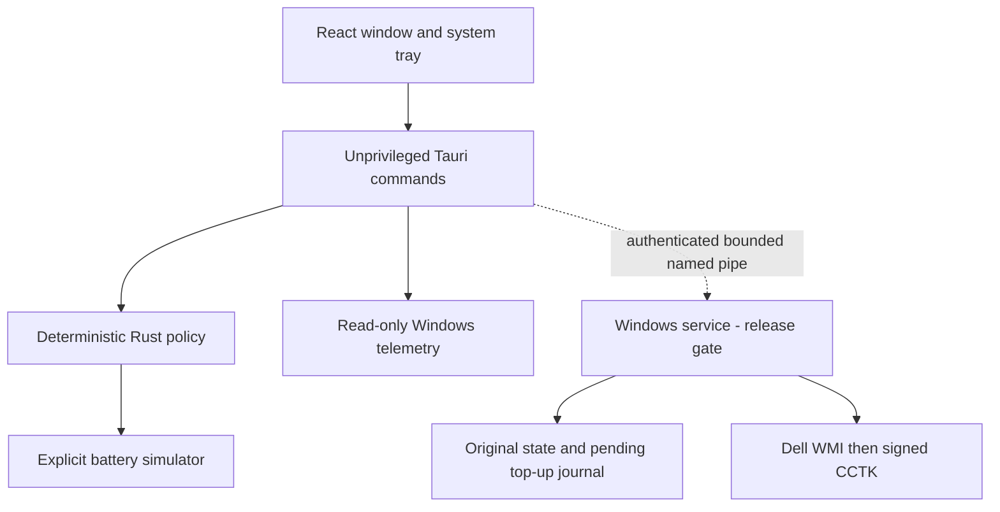

# Chargekeeper — Windows implementation plan

Scope: Windows only, Dell Latitude first. Research date: 2026-11-15.
Delivery is limited to three implementation/review iterations. Hardware verification
is a release gate, never inferred from a successful command or mock test.

## Research and interface provenance

Windows has no portable charge-limit API. The battery IOCTL interface provides
status, capacity, rate and battery tags; it does not imply arbitrary charge caps.
[Microsoft battery information](https://learn.microsoft.com/en-us/windows/win32/power/battery-information).
Tags must be reacquired following removal or replacement; unknown values remain null.

Dell Command | Monitor exposes `root\dcim\sysman`, `DCIM_BIOSEnumeration`
and `DCIM_BIOSService.SetBIOSAttributes`. Attribute names and value mappings must
be discovered from the actual instances, not assumed to equal CCTK names.
[Dell 9.3 examples](https://dl.dell.com/topicspdf/command-monitor-v9.3_users-guide_en-us.pdf),
[Dell 10.7 FAQ](https://www.dell.com/support/manuals/en-us/command-monitor/dellcommandmonitor_10.7_ug/frequently-asked-questions-for-dell-command-monitor-107?guid=guid-ff9254a6-ed6b-4dd2-b330-9f6b9498de19&lang=en-us).
Older Dell documents name DCIM_BootService; do not substitute it silently.
Discover service method metadata before enabling any write.

The documented CCTK syntax is `--PrimaryBattChargeCfg=Custom:50-80` and
`--PrimaryBattChargeCfg=Standard`. Published ranges are start 50–95, stop 55–100,
gap >=5; these are documentation facts, NOT a replacement for device-discovered
ranges. A requested 50% cap therefore cannot be promised on this Dell interface.
[Dell CLI reference](https://www.dell.com/support/manuals/en-al/command-configure-v4.1/dcc_cli_4.1.0/-primarybattchargecfg?guid=guid-681d4efe-eed0-4d0f-b290-afdd74e81765&lang=en-us),
[attribute name mapping](https://www.dell.com/support/kbdoc/en-us/000146727/reference-list-for-updated-names-of-attributes-and-possible-values).
Prefer Monitor WMI, fall back to the signed CCTK binary in Program Files.
Never pass a BIOS password on a process command line. Password-required CCTK
writes stay disabled until a secure vendor-supported credential path is verified.
Original BIOS state must be durably journaled before writes; each write needs
readback, and failed verification must not report enforcement.

| Provider | Documented mechanism | Release status |
|---|---|---|
| Dell Latitude | Monitor WMI / Command Configure Custom thresholds | Read-only probe; writes blocked pending device validation |
| Lenovo | Vantage Conservation / model-specific thresholds | Not implemented, no inferred WMI methods |
| ASUS | MyASUS 60/80/100 on older models | Not implemented |
| HP | BIOS Battery Health Manager | Not implemented |
| Surface | UEFI 50% / supported Surface app 80% | Not implemented |
| Framework | Device-specific EC | Not implemented; no arbitrary EC access |
| Samsung / MSI / Acer / Huawei | Model-specific vendor mechanisms | Not implemented |
| Generic Windows | Power status / battery telemetry | Read-only software reminders |
| Simulator | In-memory firmware and battery | Development only, prominently labeled |

Secondary evidence: [Lenovo](https://pcsupport.lenovo.com/ng/en/products/laptops-and-netbooks/100-series/130s-11igm/81kt/solutions/ht103159-battery-charge-stops-at-60-plugged-in-not-charging-windows-ideapad),
[ASUS](https://www.asus.com/support/faq/1032726/),
[HP](https://support.hp.com/si-en/document/ish_4449597-3519507-16),
[Surface](https://support.microsoft.com/en-us/surface/battery/smart-charging-on-surface).
Vendor detection alone never grants a write capability. Experimental opt-in is
not authorization to write unknown attributes.

## Architecture

Tauri 2 + React/TypeScript, platform-agnostic Rust core. No web backend, telemetry,
updater or runtime internet access. Ten-second telemetry polling, serialized
requests, monotonic policy durations; performance budget requires measurement.

The privileged service must expose only typed status/limit/threshold/inhibit/
discharge/restore operations. Reject unknown JSON fields, oversized messages,
nonlocal callers, non-owner sessions, invalid ranges and unsupported capabilities.
Read operations need no elevation. A service writer must authenticate each client
and protect its journal with ProgramData ACLs. No generic command runner or raw
WMI/key access may be reachable through IPC.

Firmware caps persist on app exit. Software-driven actions need a monotonic
lease/watchdog, restoring firmware defaults on lease expiry. A user-selected
Standard reset differs from uninstall restoration of the original BIOS mode.
Temporary top-up records its saved thresholds before changing to Standard;
restart recovery restores them conservatively. Heat inhibition requires actual
battery temperature plus inhibit support. Calibration requires force discharge,
never drains below 20%, and must cancel on stale telemetry or loss of ownership.

## Milestones / release gates

1. M1: simulator, policy tests, usable UI, honest capability gating.
2. M2: read-only Dell discovery; then authenticated service, durable journal,
   password handling, dynamic bounds, transactional writes/readback; real Latitude
   charge/reboot/password verification before claiming Dell support.
3. M3: read-only fallback and reminders; secondary vendors only with evidence.
4. M4: software modes, notifications, tray/login, lifecycle and drift handling.
5. M5: Windows build/CI, installer/uninstaller, signing, security and performance
   review. Do not package a read-only scaffold as a verified limiter.

## Current hardware evidence and risks

Read-only WMI reports Dell Inc., Latitude 7320 Detachable. Win32_Battery returned
no instances during the initial probe; this does not prove the hardware lacks a
battery. Dell provider presence, battery IOCTLs, firmware range discovery and
charge enforcement remain separate checks. BIOS updates can invalidate capability
evidence. No BIOS settings have been changed by development probes.

Production release blockers include unverified firmware interfaces, credentials,
installer restoration, service trust boundaries and physical charge verification.
Signing requires the owner's certificate and publisher identity. Reboot, AC
unplugging, BIOS password entry and physical battery tests cannot be fabricated.
