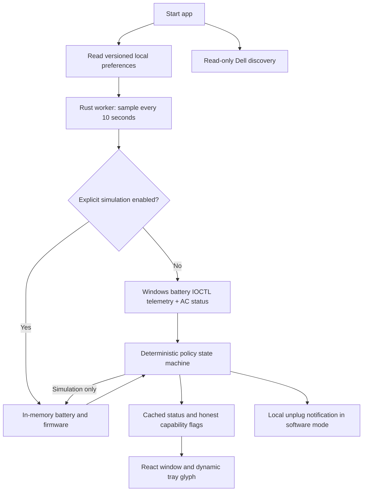

# Chargekeeper: how it works, security, and shipping plan

Status: development build, Windows only. **Real hardware is read-only. This build
does not stop physical battery charging.** The simulator implements the modes;
the Dell module constructs/parses documented commands and tests readback behavior
against mocks. A privileged BIOS-writing service is not implemented.

Final verification date: 2026-11-16. Work stopped after the requested three
implementation/review iterations. M1 has a compiled developer preview; M2–M5
remain partial. The original production acceptance criteria are not all met.

## What runs today

The UI is a local React/TypeScript bundle inside Tauri 2. Its blue-white battery
theme uses gold accents, light/dark system colors and keyboard-accessible controls.
There is no server, account, analytics, remote content or automatic update check.

A Rust worker samples Windows battery status every ten seconds independently of
the window. The `battery` crate uses Windows battery interfaces; AC presence comes
from `GetSystemPowerStatus`. Each battery has its own displayed reading. Missing
temperature, cycle count or health stays blank rather than becoming invented data.
The dependency conflates unknown and zero power, so zero-rate readings are also
shown as unavailable. Its idle-AC “Full” state is corrected to “not charging”
unless measured charge is at least 99.5%.
The UI reads a cached snapshot every two seconds. Closing hides the window; the
tray menu reopens it or quits. Idle CPU/RAM targets still require measurement.

Hardware discovery runs a fixed read-only PowerShell probe once at startup. It
reads manufacturer, model and BIOS version and checks Dell Monitor WMI class/method
presence and standard Command Configure paths. Presence is not proof of supported
attributes, trusted binaries, valid ranges or successful charging control. For
that reason discovery never enables a hardware write capability.

## Policy and modes

The platform-independent Rust core expresses decisions rather than accessing
hardware. It applies sailing hysteresis, a three-degree thermal hysteresis band,
a 20% safety floor, stale-data checks and monotonic time. Multi-battery safety
uses the lowest pack; the highest pack drives ordinary cap decisions.

Top-up targets 100% once, then returns to the saved limit. Simulated calibration
charges to full, holds for ten virtual minutes, discharges to 25%, then recharges.
The low-battery floor, lost AC, invalid data or a sampling gap cancels unsafe
actions. Simulation advances ten virtual seconds per worker tick. Simulation
changes never overwrite real preferences and never touch firmware.

On real hardware, unavailable charge-control capabilities disable top-up,
calibration, heat inhibition, sailing and force discharge. The available threshold
is an unplug reminder. The app does not label ordinary idle charging as an
enforced hold. A restore-to-Standard control is disabled on actual hardware.

Preferences live under the Tauri app's Windows Roaming AppData directory in
`config.json`. Schema 0 migrates to 1; unknown future versions and corrupt files
are preserved and saving is blocked. Diagnostics and bounded JSON event logs live
in Local AppData. Export uses selected fields, not raw hardware dumps.

## Dell path and the missing privileged layer

Official Dell documents specify Monitor's `root\dcim\sysman` and
`DCIM_BIOSService.SetBIOSAttributes`, and CCTK's
`--PrimaryBattChargeCfg=Custom:75-80`. Exact WMI attribute names and numeric
value mappings must come from the machine. Sources and caveats are in
[docs/PLAN.md](docs/PLAN.md).

The pure Dell adapter validates device-supplied bounds, constructs an argument
vector, rejects ambiguous output, records original state before a change, and
requires exact readback. Tests cover malformed output, invalid bounds, journal
failure and readback mismatch. This is a transport contract, not a production
driver. No CCTK process is executed by the app, and no BIOS write occurs.

The future service protocol defines only status, limit, thresholds, inhibit,
discharge and restore commands. A tested lease expires after 30 monotonic seconds.
**There is no installed service or operational watchdog yet.** Production needs
authenticated local named pipes, protected machine state, real adapters, secure
password handling and a restoration-aware installer before connecting this code.

Firmware limits normally persist while the UI is closed. Software-driven modes
need a live controller lease. Uninstall must restore the recorded original mode;
an explicit Standard button must set Standard. These are distinct operations.
Crash-safe travel mode needs a durable pending-state journal and conservative
restart recovery. These behaviors are design requirements, not verified features.

## Security: reducing attack surface, without an “unhackable” claim

No program can promise that it cannot be hacked. This build limits the damage
available through its own commands and records the work needed before elevation.

| Threat | Existing mitigation | Remaining work |
|---|---|---|
| Compromised renderer writes BIOS | No hardware writer or privileged process is reachable | Implement and independently review the service boundary |
| Script/command injection | Local bundled UI, restrictive CSP, typed commands; fixed discovery script; no shell plugin | Audit all dependencies and custom commands before stable release |
| Arbitrary external navigation | Dell help uses one fixed URL opened only on user action | Test default-browser behavior on Windows |
| Invalid IPC | Bounded 4096-byte future-service request decoder, unknown fields rejected, typed values and capability checks | Authenticate every service request and enforce pipe ACLs; JSON validation is not authentication |
| Malicious local process | App runs as current user, no administrator BIOS operations | Named-pipe owner/session authorization, signature validation, remote-client rejection |
| Stolen BIOS password | This build never requests, stores or transmits one | Credential Manager/DPAPI with owner-bound access; zeroize transient buffers; never use command-line secrets |
| Controller crash or suspend | Physical hardware is unchanged; policy and lease logic tested with mocks | Operational service watchdog, lifecycle recovery and physical tests |
| Diagnostic data leak | Explicit export allowlist excludes serials, passwords, username and raw WMI output | Review exported samples on real devices; local preferences are not encrypted secrets |
| Supply-chain compromise | Lockfiles, pinned CI action commits, no automatic updater | Dependency license/advisory review, SBOM, signed artifacts and release provenance |
| Firmware/tool drift | Hardware write capabilities stay off | Reprobe model/firmware/metadata, verify vendor binary signature, detect readback drift |

Same-user malware or an administrator can tamper with files and the runtime.
The current protections do not claim resistance to a compromised Windows kernel,
administrator account, malicious firmware or physical attacks. Unknown hardware
and missing metadata must continue to fail closed for writes.

The UI itself has access to local notifications and current-user launch-at-login.
It has no generic filesystem or shell permission. Custom Rust commands still
need review: Tauri capability configuration is not a substitute for validation
inside those commands. Current custom commands use fixed paths/URLs and validate
configuration and simulated telemetry in Rust.

## Verification evidence

- The first Rust core run found an unknown-field parsing failure: Serde's unit
  enum variant accepted extra fields. Converting those variants to empty struct
  variants fixed it; the rerun passed all 17 core tests.
- TypeScript checking and Vite production builds pass, including the subagent's
  independent UI/functionality review. The review caught UI-dependent polling and
  a desktop support-link issue; both were corrected in iteration 2.
- The final review identified simulated low-battery restoration and interrupted
  calibration recovery defects, plus ambiguous dependency telemetry. Iteration 3
  corrected them and added regression coverage; final results are recorded below.
- Windows WMI identified a Dell Latitude 7320 Detachable on BIOS 1.50.0. Dell
  Monitor WMI and CCTK were not detected by the read-only probe. The initial
  `Win32_Battery` query returned no instances. This is identification, not charge
  limiting verification.
- Local browser-preview screenshots were inspected; a dark-mode text color
  inheritance issue was corrected and the final screenshot checked. Interactive
  desktop scenarios and packaged-installer smoke tests,
  physical charging, reboot,
  password, uninstall restoration and performance tests remain unverified.
- `cargo build -p chargekeeper --locked --offline` passes on Windows x64.
- `cargo test --workspace --locked --offline` passes: 19 core tests plus one
  Windows telemetry-adapter test, 20 total.
- `cargo clippy --workspace --all-targets --locked --offline -- -D warnings`
  and `cargo fmt --all --check` pass. The final frontend production build passes.
- `npm run tauri -- build --debug --no-bundle` passes, producing the unsigned
  standalone `target/debug/chargekeeper.exe` with embedded frontend assets. It
  remained running during a six-second hidden startup smoke test and the test
  process was then stopped. This does not verify interactive UI workflows.
- Raw Cargo debug builds use the development URL and need the Vite server;
  use the Tauri build command above for the standalone developer executable.
- No Rust advisory scan, independent security audit or fuzz campaign was run.
  Windows CI is supplied but has not run on a hosted runner. Installer creation,
  code signing and release-mode compilation were not exercised.

## Minimal shipping plan

1. **Development preview:** finish Windows compilation, smoke-test telemetry,
   hidden-window reminders, tray, simulation, preferences and diagnostics. Ship
   only as a monitor/simulator with the current limitation prominently displayed.
2. **Dell alpha:** implement the minimal authenticated Windows service and one
   documented Dell adapter. Require dynamic metadata, original-state journaling,
   secure credentials and verified readback. Do not add secondary vendor writes
   before this works reliably.
3. **Latitude qualification:** complete [docs/DEVICES.md](docs/DEVICES.md), including
   physical 80% enforcement, sleep/reboot, wrong passwords, drift, crash recovery
   and restore/uninstall behavior. Record model, BIOS and Dell tool version.
4. **Security and release:** review service IPC and elevation, measure CPU/RAM,
   review dependency advisories/licenses, produce SBOM, sign binaries/installer,
   then test installation, upgrade and uninstall on clean Windows machines.
5. **Stable release:** publish signed checksummed artifacts, support policy,
   known-device table and reproducible build instructions. Keep unsupported
   devices in reminder mode and document every experimental provider.

The existing packaging script builds Tauri MSI or NSIS development installers;
it does not implement service removal or BIOS restoration. MSIX is not supplied;
MSI satisfies the requested MSI/MSIX packaging choice. The owner must supply an
Authenticode certificate, publisher identity and signing method. Signing keys
belong in a protected signing service or hardware-backed store, never the repo.
Configure Tauri's Windows signing settings and timestamp signatures, then verify
them with Windows SignTool. No updater is installed; any future updater needs
independent signed-manifest verification and user-triggered behavior.

## Open-source plan

The repository includes an MIT license, contribution guide, security-policy draft,
provider-extension guide, device checklist and Windows CI workflow. All vendor
control research is linked; no vendor-control source was copied.

Before publishing, choose the repository owner/name, enable private vulnerability
reporting, update SECURITY.md with the real reporting URL, review licensing and
remove generated/private artifacts. Keep certificates, credentials, `.tools`,
diagnostics and build output out of source control. The lockfiles belong in git.
Protect the main branch, require Windows checks and reviews for hardware/service
changes, and make first releases explicitly prerelease. Do not claim verified
hardware from a simulated test. Public hosting/release publication has not been
performed by this task.
